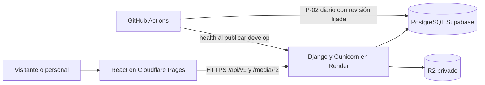

# Base para la documentación técnica de EnObra

<!-- enobra-documentacion-vigente -->
> Guía vigente. Revisión documental: 3-nov-2026.
> [Base y límites técnicos](estado-proyecto.md). Las evidencias no se reinterpretan como nuevas ejecuciones.
<!-- /enobra-documentacion-vigente -->
Corte funcional: `7d0dd21`, 3-nov-2026, America/Guatemala. Esta base prepara la
redacción del manual técnico; no es todavía el documento Word final. Los cambios
actuales son documentales y no alteran código, infraestructura ni datos.

## Fuentes y criterio de verdad

1. Código versionado y configuración: describen el comportamiento implementado.
2. `docs/openapi.yaml`: contrato publicado; contiene 38 rutas y 55 operaciones.
3. Lockfiles: versiones resueltas, distintas de los rangos de requirements.in/package.json.
4. Informes fechados: acreditan únicamente los resultados y entornos que indican.
5. Estado del proyecto: decisiones operativas y pendientes, sin convertir pruebas
   locales o propuestas en evidencia de producción.

El [inventario](INVENTARIO-DOCUMENTACION.md) distingue guías vigentes de evidencias
fechadas y señala los documentos retirados. El historial Git conserva sus versiones.

## Sistema y despliegue

| Elemento | Situación documentada |
| --- | --- |
| Aplicación | Monorepo Django/DRF y React/Vite; HTTP REST, sin conexión directa de React a Supabase. |
| Frontend | Cloudflare Pages, enobra.com.gt; rama frontend-dev, raíz frontend, npm run build, dist. |
| API | Render Free, enobra-api.onrender.com; develop, raíz backend, config.production y Gunicorn. |
| Base | PostgreSQL de Supabase, veinte tablas existentes, modelos managed=False. |
| Imágenes | R2 privado; Django guarda y entrega archivos por API según visibilidad/autorización. |
| Sesión | JWT Bearer; access 15 minutos, refresh revocable 7 días; tokens del panel en memoria. |
| Autorización | Tres roles fijos calculados en código; IDs/asignaciones en BD. Ingeniero es alias de Administrador. |
| Limpieza | GitHub Actions diario de P-02, 03:00 Guatemala; backend fijado a SHA revisado. |
| Arranque Free | Inicio solicita health una vez por carga; Actions reintenta al publicar develop. Sin health periódico. |

La limpieza ejecuta el comando backend desde un runner; no llama a una ruta de
borrado de la API. Health solo acredita respuesta HTTP, no conexión a base ni
versión. No ejecutar migraciones/seeds para recrear las tablas de negocio.

## Índice propuesto del manual

| Capítulo | Fuente vigente |
| --- | --- |
| Presentación, alcance y requisitos | README raíz, backend/README, frontend/README y estado-proyecto. |
| Arquitectura y patrones | arquitectura.md, bindings.py, interfaces y registro de publicaciones. |
| Tecnologías y versiones | requirements.txt, package-lock.json y tabla de esta base. |
| Estructura y componentes | Código backend/apps, persistence, frontend/src y sus README vigentes. |
| Modelo y diccionario de datos | DICCIONARIO-DATOS.md y persistence/models; contrastar esquema real con evidencia BE-10. |
| API REST y errores | openapi.yaml, serializers, views y admin-backend.md. |
| Autenticación y roles | RBAC.md, politica-roles-fijos.md, usuarios-api.md y FE-08. |
| Sitio y panel | frontend/README, usuarios-frontend.md, visibilidad-panel.md y README de Proyectos. |
| Imágenes y publicaciones | R2-configuracion.md, papelera.md y referencias de medios. |
| Auditoría y tareas | auditoria.md, P02-limpieza-activa.md y workflows. |
| Instalación y configuración | README de cada aplicación y archivos .env.example, sin secretos. |
| Producción y diagnóstico | infraestructura.md, Render-backend.md y operacion-produccion.md. |
| Pruebas y límites | Estado vigente y evidencias fechadas; separar SQLite, Supabase y URL desplegada. |
| Mantenimiento y pendientes | estado-proyecto.md, dependencias-juan.md y responsables-y-cierres.md. |
| Glosario y anexos | Conceptos usados y referencias verificadas; sin copiar documentos retirados. |

## Límites que deben aparecer en el manual

- El login del panel usa usuario/usuario_rol y hashes verificados por Django; no
  confundir estas cuentas con Supabase Auth o los accesos al dashboard del proveedor.
- El editor administrativo de Empresa/Nosotros sigue pendiente en frontend; la API
  de empresa/institución existe, pero no acredita que haya una pantalla de edición.
- Servicios y búsqueda global tienen contrato, pero no repositorios registrados:
  responden 501; no describirlos como módulos backend terminados.
- R2 privado activo. Una imagen migrada se recuperó tras otro despliegue; faltan
  cuatro originales. La subida/publicación desde el panel desplegado sigue pendiente.
- Correo usa backend dummy en validación; falta proveedor/remitente/destinatario y
  prueba de entrega. Registrar una consulta no acredita notificación recibida.
- Cuentas activas consultadas; falta recorrido real de login/permisos con titulares.
  No publicar correos personales, contraseñas ni hashes en el manual.
- Las propuestas SQL conservadas en docs/sql no acreditan tablas o migraciones
  aplicadas. El diccionario describe modelos existentes, no diseños propuestos.
- El código de limpieza programada está fijado a otra revisión probada; no asumir
  que cada cambio de develop actualiza automáticamente ese comando en main.
- Render se despliega manualmente; sincronizar ramas no equivale a desplegar backend.

## Exposición y cuentas definitivas

La exposición está prevista para el **4 de noviembre de 2026**. La depuración de
cuentas de Supabase se aplaza hasta después de esa exposición. El objetivo indicado
es conservar una cuenta Admin y otra del Ingeniero; titulares/correos se definirán
más adelante por el usuario. No se han eliminado cuentas ni se documentan IDs o
correos supuestos. La política actual trata Ingeniero como Administrador.

Esta decisión no cambia la cuenta técnica no interactiva de P-02: revisar sus
relaciones y el actor del workflow antes de preparar cualquier depuración futura.
La lista concreta de cuentas, respaldo, relaciones/auditoría y tratamiento de esa
cuenta técnica deberán resolverse antes de ejecutar la eliminación.

## Preparación del documento final

El [prompt actualizado](PROMPT-MANUAL-TECNICO-ENOBRA.md) sirve para iniciar el manual.
Faltan portada/nombres/carnés aprobados y el manual de usuario de referencia si se
requiere reproducir su formato. No inventarlos ni trasladar datos personales del
repositorio o de la base. Preparar diagramas a partir de código; no presentar mocks
como capturas reales. El documento final debe distinguir implementación, despliegue
y comprobación funcional. Esta actualización no genera todavía DOCX/PDF.

## Versiones resueltas del corte

| Tecnología | Versión | Fuente |
| --- | --- | --- |
| Python (Render/CI) | 3.12.16 | `backend/.python-version` |
| Django | 5.2.19 | `backend/requirements.txt` |
| Django REST Framework | 3.18.3 | `backend/requirements.txt` |
| Gunicorn | 26.2.0 | `backend/requirements.txt` |
| django-storages | 1.14.6 | `backend/requirements.txt` |
| boto3 | 1.43.123 | `backend/requirements.txt` |
| react | 18.3.1 | `frontend/package-lock.json` |
| react-router-dom | 7.18.4 | `frontend/package-lock.json` |
| vite | 6.4.4 | `frontend/package-lock.json` |
| tailwindcss | 4.3.3 | `frontend/package-lock.json` |
| lucide-react | 1.55.0 | `frontend/package-lock.json` |

Node.js se rige por engines de frontend/package.json (>=20.19 o >=22.12). No se
inventa una versión del servidor PostgreSQL: debe confirmarse en Supabase.
