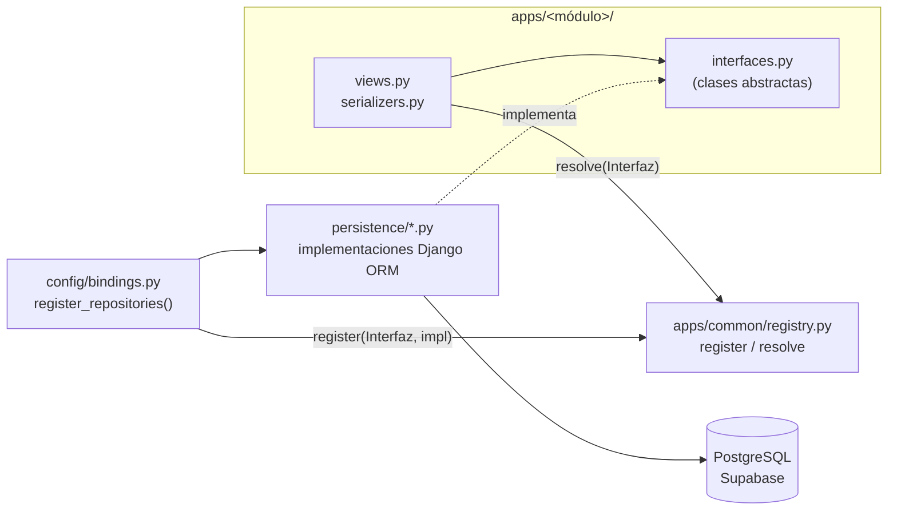
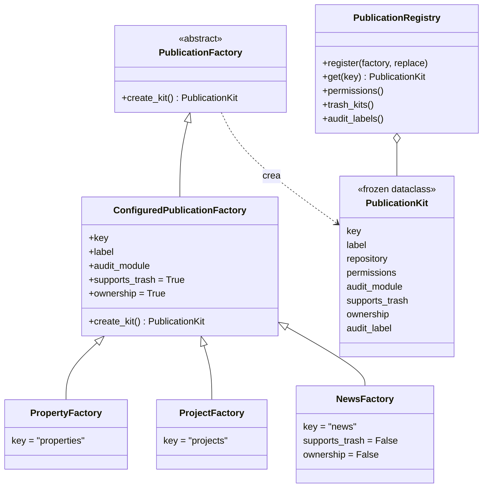

# Arquitectura del backend (BE-11)

Estado al 25 de octubre de 2026, sobre `backend-dev`.
Referencias: [RBAC](RBAC.md), [ADR 0001](adr/0001-rbac-por-datos.md),
[papelera](papelera.md), [auditoría](auditoria.md) y
[backend del administrador](admin-backend.md).

## Capas

El backend es Django 5.2 + DRF sobre PostgreSQL (Supabase) con modelos `managed=False`.
Las vistas no importan el ORM: dependen de **interfaces** y piden la implementación a un
**registro**. Toda la unión entre ambas capas está en un solo archivo,
`backend/config/bindings.py`.



| Pieza | Dónde | Qué hace |
| --- | --- | --- |
| Interfaces | `apps/<módulo>/interfaces.py` | Contrato abstracto del módulo: `PropertyRepository`, `AuditRepository`, `InquiryNotifier`, ... |
| Registro | `apps/common/registry.py` | `register(interfaz, implementación)` y `resolve(interfaz)`. |
| Acople | `config/bindings.py` | `register_repositories()` crea cada implementación y la registra. Es el **único** archivo que conoce ambas capas. |
| Implementaciones | `persistence/` | Django ORM sobre las tablas existentes (`catalog.py`, `users.py`, `audit.py`, ...). |
| Permisos | `apps/common/permissions.py`, `apps/common/rbac.py` | `ResourcePermission` y el catálogo de permisos (ver [RBAC](RBAC.md)). |

Si una interfaz no tiene implementación registrada, `resolve()` lanza `NotBoundError`
y el manejador de errores (`apps/common/errors.py`) responde **501 `not_implemented`**.
Así están hoy Servicios y Búsqueda.

Para cambiar una implementación (por ejemplo, otro almacenamiento de imágenes) basta
escribir la clase nueva en `persistence/` y cambiar una línea de `bindings.py`. Las
vistas y las pruebas de API no cambian.

## Fábrica de publicaciones (Abstract Factory)

Bienes raíces, proyectos y noticias son **tipos de publicación** con el mismo molde:
repositorio, familia de permisos, papelera (o no) y un módulo en el historial. En lugar
de repetir esa configuración en cada módulo, cada tipo tiene una **fábrica** que entrega
su "kit", y un **registro** reúne todos los kits.



Archivos, todos en `backend/apps/publications/`:

| Archivo | Contenido |
| --- | --- |
| `interfaces.py` | `PublicationKit` (dataclass inmutable) y la clase abstracta `PublicationFactory`. |
| `factory.py` | `ConfiguredPublicationFactory` (fábrica declarativa: la subclase solo define atributos) y las tres fábricas concretas. |
| `registry.py` | `PublicationRegistry` y la instancia única `publication_registry`. |
| `views.py` | `GET /api/v1/admin/trash/?type=`: la papelera unificada, que lee los tipos del registro. |

### Qué se deriva del registro

El registro es la **fuente única** de tres cosas; ninguna se escribe a mano por tipo:

1. **Catálogo de permisos.** `permission_catalog()` (`apps/accounts/access_policy.py`)
   suma a los permisos de la plataforma los de cada kit, generados con
   `publication_permissions(key, label, ownership=..., trash=...)`. El seed y el rol
   Ingeniero los reciben sin más cambios.
2. **Tipos de la papelera unificada.** `/admin/trash/` acepta en `type` solo los kits con
   `supports_trash=True` (hoy `properties` y `projects`), llama a
   `kit.repository.list_trash(...)` y calcula quién ve todo o solo lo propio con
   `trash_access(kit.key)`.
3. **Etiquetas del historial.** `publication_registry.audit_label("projects")` devuelve
   "Proyectos". La API de historial todavía no la usa.

### Validaciones al registrar

`PublicationRegistry.register()` rechaza al iniciar la aplicación, no en producción:

- una clave que no cumpla `^[a-z][a-z0-9_]*$`;
- una clave repetida (salvo con `replace=True`, que hace el registro idempotente);
- permisos que no empiecen por `<key>.` o que ya pertenezcan a otro tipo;
- un `audit_module` repetido;
- `supports_trash=True` con un repositorio sin `list_trash`, `restore` y
  `delete_permanently`.

### Qué no hace la fábrica

La fábrica no genera modelos, serializers, vistas ni URLs: cada tipo tiene los suyos,
porque sus campos y reglas difieren (el terreno no tiene habitaciones, la noticia no
tiene papelera). Tampoco decide los roles; los roles son datos (ver
[ADR 0001](adr/0001-rbac-por-datos.md)).

## Cómo agregar un tipo de publicación

Ejemplo: **terrenos**. La prueba
`NewPublicationTypeNeedsOnlyAClassAndARegistrationTests`
(`backend/tests/test_publication_factory.py`) lo hace con un repositorio falso y
comprueba que el tipo aparece en el catálogo, en el seed y en la papelera sin tocar
ningún otro archivo.

1. **Interfaz.** Crear `apps/terrenos/interfaces.py` con `LandRepository`. Si tendrá
   papelera, debe incluir `list_trash(page, page_size, owner_id)`, `restore(key, restored_by)`
   y `delete_permanently(key, deleted_by)`.
2. **Implementación.** En `persistence/`, heredar de `CatalogRepository` (como
   `DjangoPropertyRepository`) con `supports_trash = True`; así hereda la papelera.
3. **Fábrica.** En `apps/publications/factory.py`:

   ```python
   class LandFactory(ConfiguredPublicationFactory):
       key = "terrenos"
       label = "terrenos"
       # audit_module = "terrenos"   # por defecto, igual que key
       # supports_trash = True       # False: un único permiso terrenos.delete
       # ownership = True            # False: edit y trash sin .any/.own
   ```

4. **Registro.** En `config/bindings.py`, dentro de `register_repositories()`:

   ```python
   lands = DjangoLandRepository()
   register(LandRepository, lands)
   publication_registry.register(LandFactory(lands), replace=True)
   ```

5. **Vistas y rutas.** Serializers, vistas y `urls.py` del módulo, con
   `ResourcePermission` y un `permission_map` que use los permisos generados
   (`terrenos.create`, `terrenos.edit.any`, ...). Registrar la app en `settings.py` y sus
   rutas en `config/urls.py`.
6. **Datos.** `python manage.py seed_access_control` crea los 8 permisos nuevos y se los da
   al Ingeniero. Para otros roles, asignarlos desde el panel o en `builtin_roles()`.
7. **Pruebas y contrato.** Agregar pruebas de permisos del módulo, actualizar los
   conteos de `tests/test_rbac_catalog.py` y regenerar `docs/openapi.yaml`.

Con esto, `/admin/trash/?type=terrenos` y los permisos del panel de roles funcionan sin
cambiar la papelera, el catálogo ni el seed.
