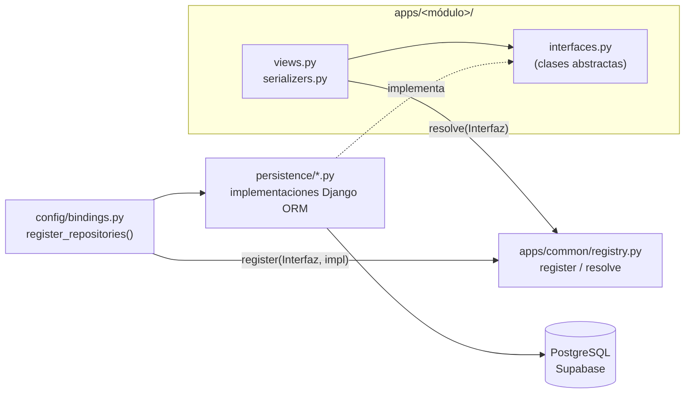
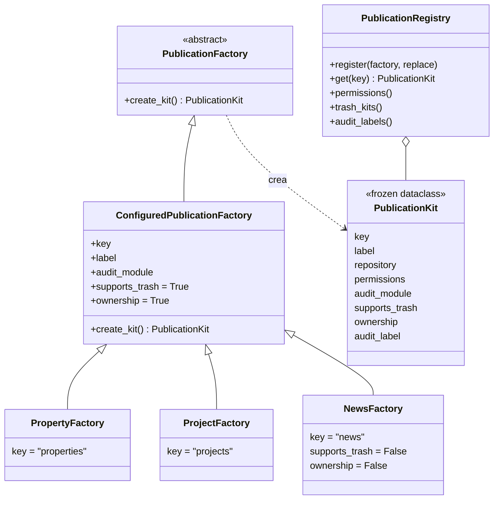

# Arquitectura del backend (BE-11)

<!-- enobra-documentacion-vigente -->
> Guía vigente. Revisión documental: 3-nov-2026.
> [Base y límites técnicos](BASE-DOCUMENTACION-TECNICA.md). Las evidencias no se reinterpretan como nuevas ejecuciones.
<!-- /enobra-documentacion-vigente -->
Estado documental del 3-nov-2026, sobre el código integrado del corte 7d0dd21.
Referencias: [RBAC](RBAC.md), [política fija](politica-roles-fijos.md),
[papelera](papelera.md), [auditoría](auditoria.md) y
[backend del administrador](admin-backend.md).

## Capas

El backend es Django 5.2 + DRF sobre PostgreSQL (Supabase) con modelos `managed=False`.
Las vistas no importan el ORM: dependen de **interfaces** y piden la implementación a un
**registro**. Toda la unión entre ambas capas está en un solo archivo,
`backend/config/bindings.py`.



| Pieza | Dónde | Qué hace |
| --- | --- | --- |
| Interfaces | `apps/<módulo>/interfaces.py` | Contrato abstracto del módulo: `PropertyRepository`, `AuditRepository`, `InquiryNotifier`, ... |
| Registro | `apps/common/registry.py` | `register(interfaz, implementación)` y `resolve(interfaz)`. |
| Acople | `config/bindings.py` | `register_repositories()` crea cada implementación y la registra. Es el **único** archivo que conoce ambas capas. |
| Implementaciones | `persistence/` | Django ORM sobre las tablas existentes (`catalog.py`, `users.py`, `audit.py`, ...). |
| Permisos | `apps/common/permissions.py`, `apps/common/rbac.py` | `ResourcePermission` y el catálogo de permisos (ver [RBAC](RBAC.md)). |

Si una interfaz no tiene implementación registrada, `resolve()` lanza `NotBoundError`
y el manejador de errores (`apps/common/errors.py`) responde **501 `not_implemented`**.
Así están hoy Servicios y Búsqueda.

Para cambiar una implementación se conserva la interfaz y se registra un adaptador
compatible en bindings.py. La selección local/R2 de default_storage también depende
de settings y variables. Revisar contrato, autorización y pruebas de integración;
el registro por sí solo no garantiza compatibilidad ni migra archivos.

## Fábrica de publicaciones (Abstract Factory)

Bienes raíces, proyectos y noticias son **tipos de publicación** con el mismo molde:
repositorio, familia de permisos, papelera (o no) y un módulo en el historial. En lugar
de repetir esa configuración en cada módulo, cada tipo tiene una **fábrica** que entrega
su "kit", y un **registro** reúne todos los kits.



Archivos, todos en `backend/apps/publications/`:

| Archivo | Contenido |
| --- | --- |
| `interfaces.py` | `PublicationKit` (dataclass inmutable) y la clase abstracta `PublicationFactory`. |
| `factory.py` | `ConfiguredPublicationFactory` (fábrica declarativa: la subclase solo define atributos) y las tres fábricas concretas. |
| `registry.py` | `PublicationRegistry` y la instancia única `publication_registry`. |
| `views.py` | `GET /api/v1/admin/trash/?type=`: la papelera unificada, que lee los tipos del registro. |

### Qué se deriva del registro

El registro es la **fuente única** de tres cosas; ninguna se escribe a mano por tipo:

1. **Catálogo de permisos.** `permission_catalog()` (`apps/accounts/access_policy.py`)
   suma a los permisos de la plataforma los de cada kit, generados con
   `publication_permissions(key, label, ownership=..., trash=...)`. El seed y el rol
   Ingeniero los reciben sin más cambios.
2. **Tipos de la papelera unificada.** `/admin/trash/` acepta en `type` solo los kits con
   `supports_trash=True` (hoy `properties` y `projects`), llama a
   `kit.repository.list_trash(...)` y calcula quién ve todo o solo lo propio con
   `trash_access(kit.key)`.
3. **Etiquetas del historial.** `publication_registry.audit_label("projects")` devuelve
   "Proyectos". La API de historial todavía no la usa.

### Validaciones al registrar

`PublicationRegistry.register()` valida al registrar cada kit durante el arranque,
también en producción:

- una clave que no cumpla `^[a-z][a-z0-9_]*$`;
- una clave repetida (salvo con `replace=True`, que hace el registro idempotente);
- permisos que no empiecen por `<key>.` o que ya pertenezcan a otro tipo;
- un `audit_module` repetido;
- `supports_trash=True` con un repositorio sin `list_trash`, `restore` y
  `delete_permanently`.

### Qué no hace la fábrica

La fábrica no genera modelos, serializers, vistas ni URLs: cada tipo tiene los suyos,
porque sus campos y reglas difieren (el terreno no tiene habitaciones, la noticia no
tiene papelera). Tampoco decide los roles humanos. Los IDs/asignaciones son datos y sus permisos
efectivos se calculan por la [política fija](politica-roles-fijos.md).

## Cómo agregar un tipo de publicación

Ejemplo: **terrenos**. La prueba
`NewPublicationTypeNeedsOnlyAClassAndARegistrationTests`
(`backend/tests/test_publication_factory.py`) lo hace con un repositorio falso y
comprueba que el tipo aparece en el catálogo, en el seed y en la papelera sin tocar
ningún otro archivo.

1. **Interfaz.** Crear `apps/terrenos/interfaces.py` con `LandRepository`. Si tendrá
   papelera, debe incluir `list_trash(page, page_size, owner_id)`, `restore(key, restored_by)`
   y `delete_permanently(key, deleted_by)`.
2. **Implementación.** En `persistence/`, heredar de `CatalogRepository` (como
   `DjangoPropertyRepository`) con `supports_trash = True`; así hereda la papelera.
3. **Fábrica.** En `apps/publications/factory.py`:

   ```python
   class LandFactory(ConfiguredPublicationFactory):
       key = "terrenos"
       label = "terrenos"
       # audit_module = "terrenos"   # por defecto, igual que key
       # supports_trash = True       # False: un único permiso terrenos.delete
       # ownership = True            # False: edit y trash sin .any/.own
   ```

4. **Registro.** En `config/bindings.py`, dentro de `register_repositories()`:

   ```python
   lands = DjangoLandRepository()
   register(LandRepository, lands)
   publication_registry.register(LandFactory(lands), replace=True)
   ```

5. **Vistas y rutas.** Serializers, vistas y `urls.py` del módulo, con
   `ResourcePermission` y un `permission_map` que use los permisos generados
   (`terrenos.create`, `terrenos.edit.any`, ...). Registrar la app en `settings.py` y sus
   rutas en `config/urls.py`.
6. **Autorización.** Revisar permission_catalog() y fixed_permissions() para el nuevo
   tipo, con pruebas por rol. No usar un editor de roles ni asignaciones RolPermiso
   para ampliar sesiones humanas. Evaluar si se requiere un cambio de datos por
   separado; esta extensión no autoriza ejecutar seed sobre Supabase.
7. **Pruebas y contrato.** Agregar pruebas de permisos del módulo, actualizar los
   conteos de `tests/test_rbac_catalog.py` y regenerar `docs/openapi.yaml`.

El ejemplo es una extensión propuesta, no un tipo de publicación implementado.
El registro permite integrar la papelera genérica; la API del nuevo módulo y su
autorización deben validarse expresamente. No existe un panel de roles editable.

## Infraestructura y archivos

Django se ejecuta con Gunicorn/config.production en Render y consulta PostgreSQL.
Los bytes de imágenes se guardan en R2 privado; MediaStorage conserva metadatos en
contenido_pagina y la API decide lectura pública/privada. El navegador no recibe
credenciales S3. Ver R2-configuracion.md y operacion-produccion.md.

Las sesiones revocables, metadatos de catálogos/papelera y medios usan claves JSON
auxiliares. No inferir tablas nuevas desde esos prefijos. El diccionario de modelos
existentes está en DICCIONARIO-DATOS.md. Servicios y búsqueda siguen sin binding.
