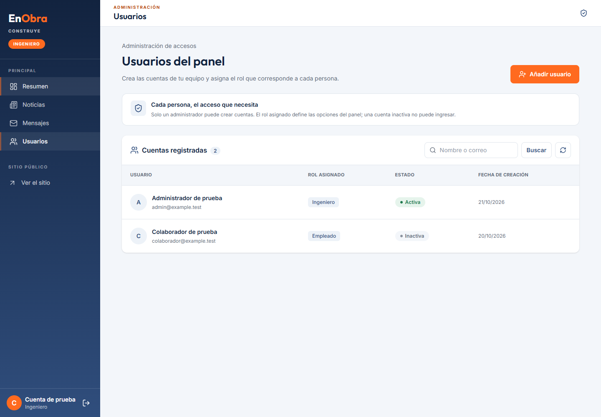
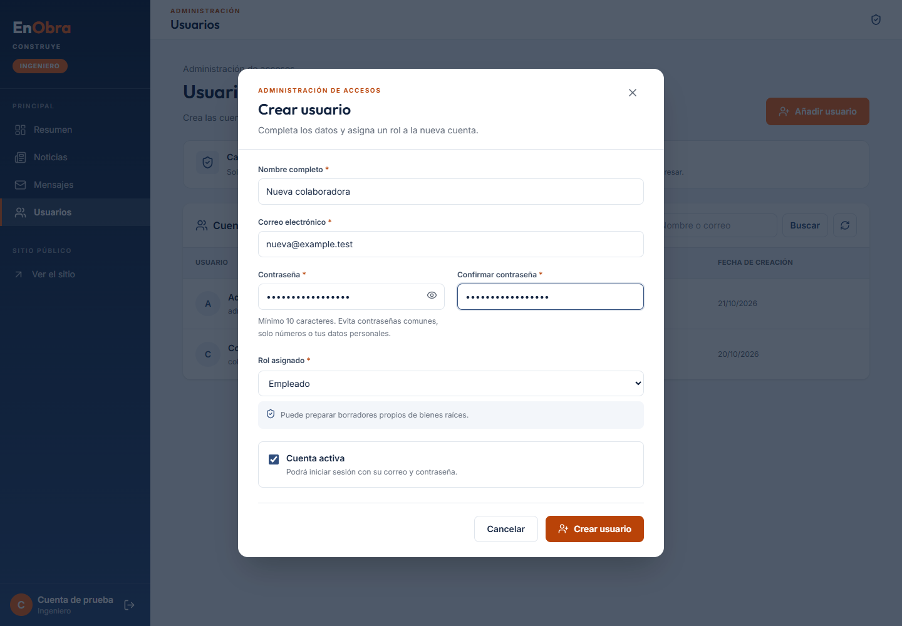
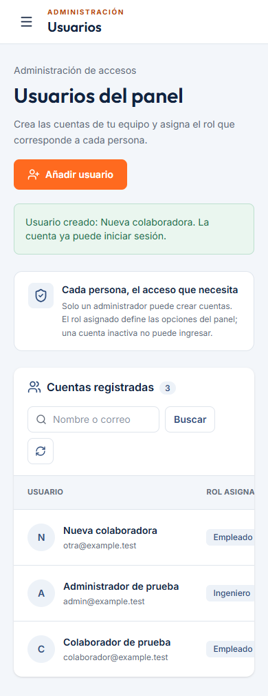
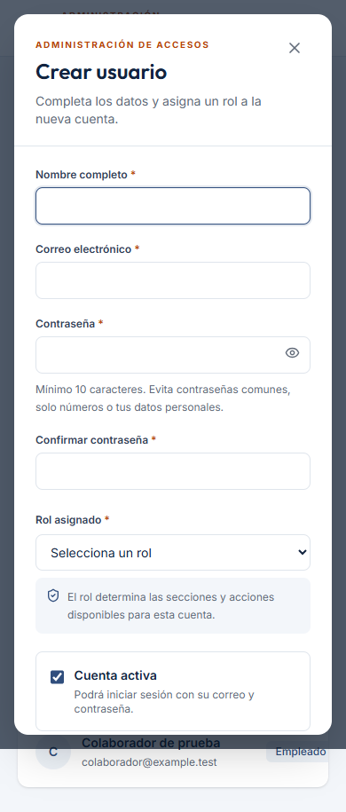

# Usuarios en el panel administrativo

<!-- enobra-documentacion-vigente -->
> Guía vigente. Revisión documental: 3-nov-2026.
> [Base y límites técnicos](BASE-DOCUMENTACION-TECNICA.md). Las evidencias no se reinterpretan como nuevas ejecuciones.
<!-- /enobra-documentacion-vigente -->
Ruta /admin/usuarios. La interfaz reutiliza AdminShell, sesión en memoria,
apiClient y permisos efectivos del backend. [Contrato API](usuarios-api.md),
[visibilidad](visibilidad-panel.md) y [roles fijos](politica-roles-fijos.md).

## Funcionalidad y permisos

- Administrador lista/crea usuarios y asigna uno de los roles fijos activos existentes.
- Arquitecto lista y edita nombre/estado de cuentas no administradoras, sin crear
  cuentas ni reasignar roles. El servidor aplica las mismas restricciones.
- Empleado no accede a Usuarios. Una ruta rechazada redirige sin consultar la vista.
- La cuenta propia no puede desactivarse/reasignarse; tampoco puede eliminarse el
  último Administrador activo ni modificarse la cuenta técnica desde este flujo.

Formulario de alta: nombre, correo, contraseña/confirmación, rol y estado. La
confirmación no se envía; el backend recibe name/email/password/role_id/active.
El selector consulta admin/users/roles/ y conserva IDs reales. No inventar roles
faltantes ni mostrar edición de permisos. La respuesta nunca expone hashes.

El listado es paginado y permite q por nombre/correo. Editar datos usa PATCH y
reasignar usa PUT; son operaciones independientes. Si una termina y la otra falla,
conservar el éxito parcial confirmado y reintentar únicamente lo pendiente.
Las validaciones por campo no cierran el formulario ni presentan un falso éxito.

La contraseña se descarta al cerrar. Los ejemplos de desarrollo no crean usuarios
reales. React llama a Django, que accede a Supabase; no hay conexión directa de
usuarios desde el navegador ni credenciales de base en VITE_*.

## Sesión y datos definitivos

La sesión en memoria se renueva por actividad con límite de inactividad; ver FE-08.
La depuración de Supabase queda para después de la exposición del 4-nov-2026.
Se pretenden dos cuentas humanas permanentes, Admin e Ingeniero, con correos por
definir. No se eliminan ni modifican cuentas al actualizar estas guías. El nombre
Ingeniero es actualmente alias de Administrador; no implica un cuarto rol.

## Verificación y capturas

Pruebas en frontend/tests/users.test.mjs y runners de integración con datos aislados.
Las evidencias generales registran 191 pruebas frontend y 238 backend. Falta el
recorrido con titulares autorizados desde el panel desplegado.

Capturas existentes con datos ficticios, anteriores a la política visual actual;
son apoyo histórico y no una comprobación del entorno publicado:

