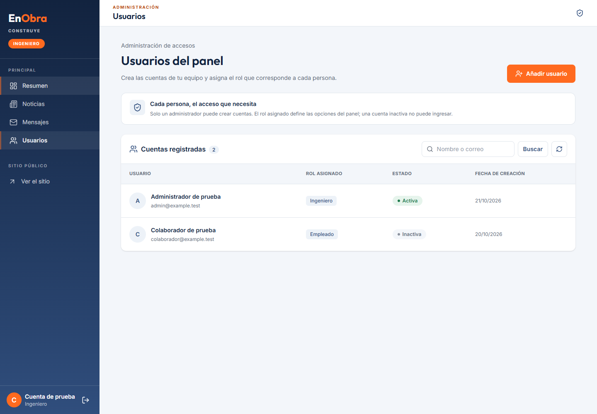
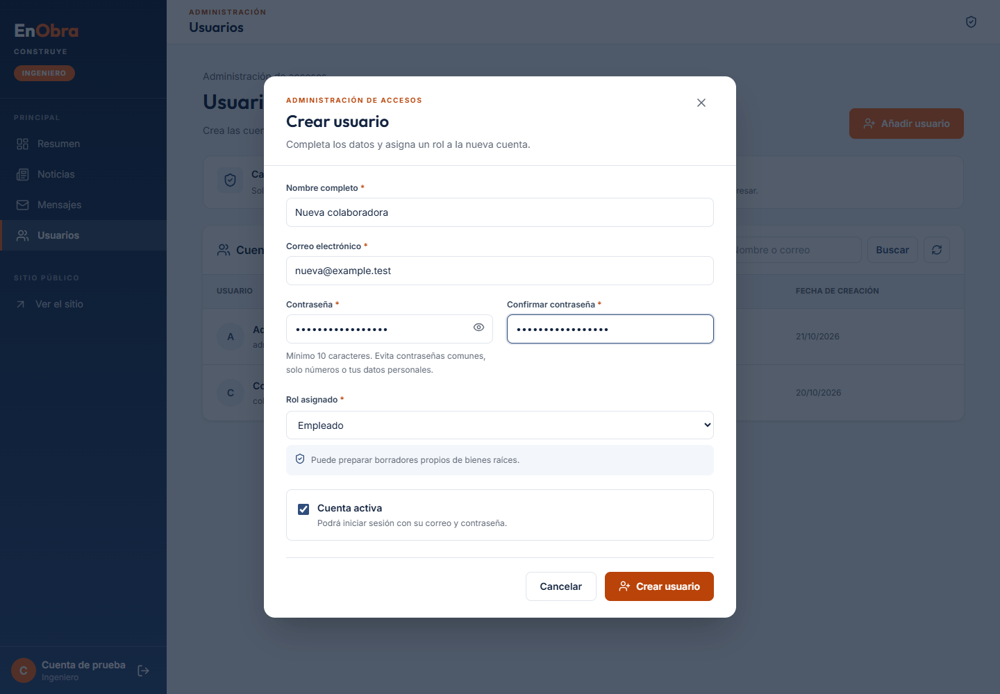
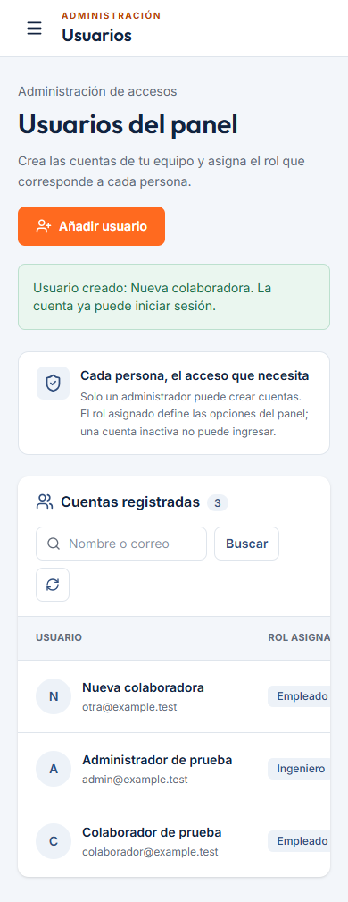
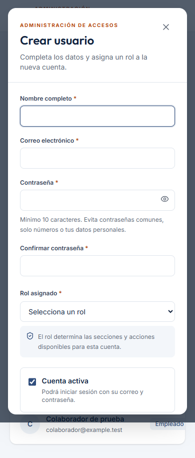

# Usuarios en el panel administrativo

<!-- enobra-documentacion-vigente -->
> Guía vigente. Revisión documental: 17-nov-2026.
> [Base y límites técnicos](BASE-DOCUMENTACION-TECNICA.md). Las evidencias no se reinterpretan como nuevas ejecuciones.
<!-- /enobra-documentacion-vigente -->
Ruta /admin/usuarios. La interfaz reutiliza AdminShell, sesión en memoria,
apiClient y permisos efectivos del backend. [Contrato API](usuarios-api.md),
[visibilidad](visibilidad-panel.md) y [roles fijos](politica-roles-fijos.md).

## Funcionalidad y permisos

- Administrador lista/crea usuarios y asigna uno de los roles fijos activos existentes.
- Arquitecto lista y edita nombre/estado de cuentas no administradoras, sin crear
  cuentas ni reasignar roles. El servidor aplica las mismas restricciones.
- Empleado no accede a Usuarios. Una ruta rechazada redirige sin consultar la vista.
- La cuenta propia no puede desactivarse/reasignarse; tampoco puede eliminarse el
  último Administrador activo ni modificarse la cuenta técnica desde este flujo.

Formulario de alta: nombre, correo, contraseña/confirmación, rol y estado. La
confirmación no se envía; el backend recibe name/email/password/role_id/active.
El selector consulta admin/users/roles/ y conserva IDs reales. No inventar roles
faltantes ni mostrar edición de permisos. La respuesta nunca expone hashes.

En `frontend-dev` se muestra el equipo en vistas de cuentas activas e inactivas.
Django pagina la búsqueda por nombre o correo. React reúne las páginas, filtra
cuentas internas o de prueba y pagina lo visible. Las filas ocultas siguen
existiendo en Supabase. Editar datos usa PATCH y reasignar usa PUT. Si solo
una escritura termina, la interfaz conserva ese resultado y permite reintentar
la otra.

La contraseña se descarta al cerrar. Los ejemplos de desarrollo no crean usuarios
reales. React llama a Django, que accede a Supabase; no hay conexión directa de
usuarios desde el navegador ni credenciales de base en VITE_*.

## Sesión y datos definitivos

La sesión en memoria se renueva por actividad con límite de inactividad; ver FE-08.
El usuario indicará los correos de Admin e Ingeniero cuando estén definidos.
La política vigente trata Ingeniero como alias de Administrador. Los titulares y
la depuración se acuerdan por separado del filtrado visual del listado.

## Verificación y capturas

Pruebas en frontend/tests/users.test.mjs y runners de integración con datos aislados.
El 17-nov pasaron las 203 pruebas de frontend en `aa96acd`. El recorrido con
titulares autorizados en producción se sigue en [estado](estado-proyecto.md).

Capturas existentes con datos ficticios, anteriores a la política visual actual;
son apoyo histórico y no una comprobación del entorno publicado:

