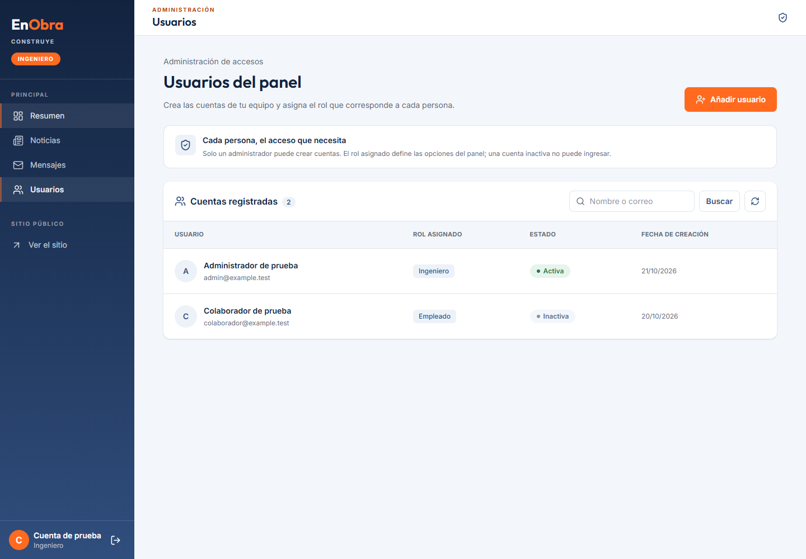
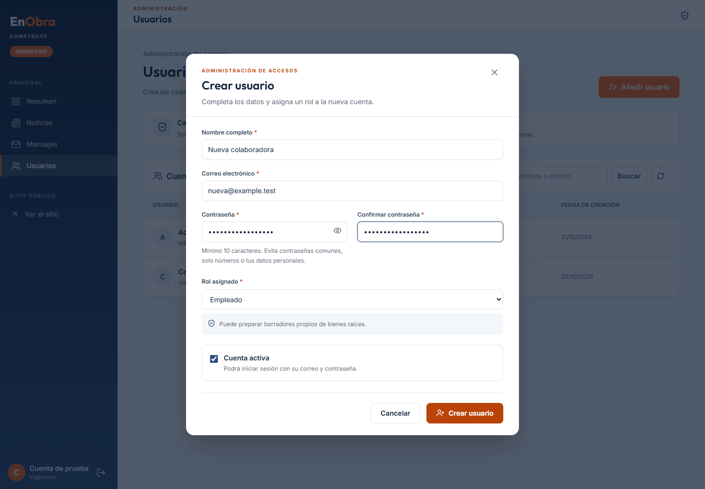
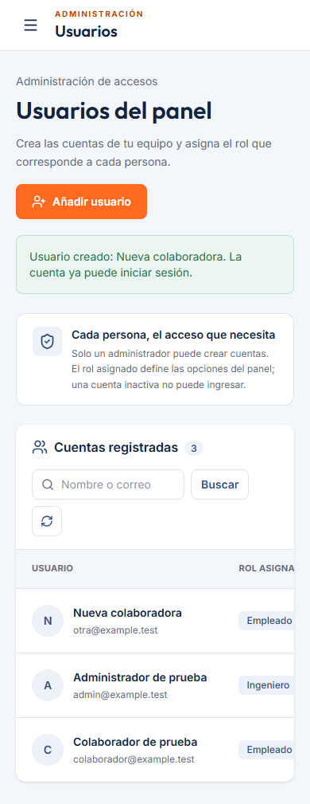
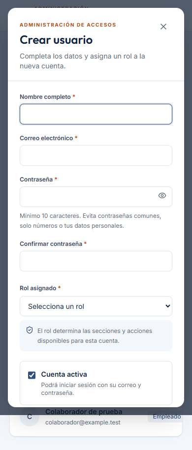

# Usuarios: creación desde el panel administrador

Interfaz en `frontend-dev`, ruta `/admin/usuarios`. Conserva el diseño del panel
existente y añade **Usuarios** a la barra lateral. Reutiliza `AdminShell`, la sesión
en memoria, `apiClient` y las comprobaciones de permisos del proyecto.

Solo las cuentas con `admin.all` ven el enlace y pueden entrar mediante la ruta.
Arquitecta y Empleado ven el aviso de acceso restringido si intentan abrirla.
El servidor también debe aplicar esa autorización; ocultar el enlace no la sustituye.

## Formulario y listado

- Nombre, correo, contraseña, confirmación, rol activo y estado de la cuenta.
- Validación local; los errores de Django aparecen por campo y no cierran el formulario.
- Listado paginado, búsqueda por nombre/correo, indicadores activo/inactivo y roles.
- Se desactiva la creación mientras se consulta el catálogo de roles o si no está disponible.
- Confirmación de éxito únicamente después de la respuesta válida de creación.
- Prevención de doble envío y contraseña descartada al cerrar el formulario.
- Diálogo nativo accesible, foco inicial y cierre por Escape; tabla desplazable en móvil.
- La demostración de desarrollo usa ejemplos en memoria; no guarda contraseñas ni crea cuentas reales.

## Conexión con Supabase

La interfaz envía las peticiones a Django; Django reutiliza la conexión PostgreSQL
de Supabase ya prevista por el proyecto. No se agregan credenciales al navegador,
almacenamiento local de usuarios ni otra conexión a la base.

El contrato complementario se implementó en la rama compartida `backend-dev`:

| Método | Ruta | Uso |
| --- | --- | --- |
| GET | `/api/v1/admin/users/?q=&page=1&page_size=12` | Listado paginado |
| GET | `/api/v1/admin/users/roles/` | Roles activos disponibles |
| POST | `/api/v1/admin/users/` | Crear cuenta y asignar rol |

El POST envía `{name, email, password, role_id, active}`. La confirmación de contraseña
no se envía. La respuesta contiene `{id, name, email, active, roles, created_at}`,
sin contraseñas ni hashes. El rol se selecciona con IDs del servidor, sin IDs fijos.
Debe integrarse el PR de backend para usar esta pantalla contra el servidor real.

## Pruebas

```powershell
npm --prefix frontend ci
npm --prefix frontend run lint
npm --prefix frontend test
npm --prefix frontend run build
```

`frontend/tests/users.test.mjs` cubre permisos, validaciones, contrato, errores y
filtrado de datos privados. `frontend/tests/browser/users.cjs` verifica el recorrido
visual con respuestas interceptadas: creación, errores, búsqueda, carga de roles,
acceso restringido y anchos de escritorio/móvil. No usa Supabase.

Para ejecutar los recorridos de navegador, iniciar Vite y configurar Playwright
y Chrome/Chromium como en las pruebas de integración existentes:

```powershell
$env:PLAYWRIGHT_MODULE = 'ruta/al/modulo/playwright'
$env:CHROMIUM_PATH = 'ruta/al/navegador/chrome.exe'
node frontend/tests/browser/users.cjs
node frontend/tests/browser/integration.cjs
```

`users-live.cjs` comprueba React contra Django sin interceptar peticiones, con
`INTEGRATION_BASE_URL`, `INTEGRATION_EMAIL` e `INTEGRATION_PASSWORD`. Opcionalmente,
`INTEGRATION_USER_EMAIL` e `INTEGRATION_INACTIVE_EMAIL` permiten usar correos únicos.
Ese recorrido crea cuentas: ejecutarlo con cuentas y datos de integración.

## Validación real con Supabase — 21 de octubre de 2026

- Se utilizó el `.env` facilitado por el usuario, únicamente como `backend/.env`
  local e ignorado por Git. No se modificó la conexión del proyecto.
- `manage.py check_database` confirmó la conexión PostgreSQL y las columnas
  esperadas en las 20 tablas existentes. No ejecuta migraciones.
- Se ejecutó el build de React contra Django real y Supabase, sin interceptar
  las peticiones de `users-live.cjs`. Se cargó el contrato de `backend-dev` para
  comprobar las dos contribuciones juntas sin mezclar los commits de cada rama.
- El formulario creó cuentas activa/inactiva, rechazó el correo duplicado y
  permitió iniciar sesión a la cuenta nueva con el rol Empleado. Esa cuenta no
  pudo acceder a Usuarios ni vio el enlace en la barra lateral.
- Se comprobaron en PostgreSQL el hash PBKDF2, la asignación de rol, el estado
  inactivo y las dos entradas de auditoría, dentro de la transacción de prueba.
- La prueba se ejecutó en una transacción con rollback. Al terminar se verificó
  mediante otra conexión que no quedaron usuarios ni auditorías temporales.
- El catálogo real consultado tenía únicamente el rol activo ADMIN. El rol
  Empleado usado para la prueba también fue temporal y se revirtió.

También pasaron 84 tests de frontend, lint, build, recorrido de Usuarios a 1440 y
390 px y el recorrido de regresión de las páginas públicas, login, Noticias y
Mensajes. El contrato de backend pasó 56 tests aislados, check y OpenAPI estricto.

## Capturas

Capturadas con datos ficticios de las pruebas de navegador:





